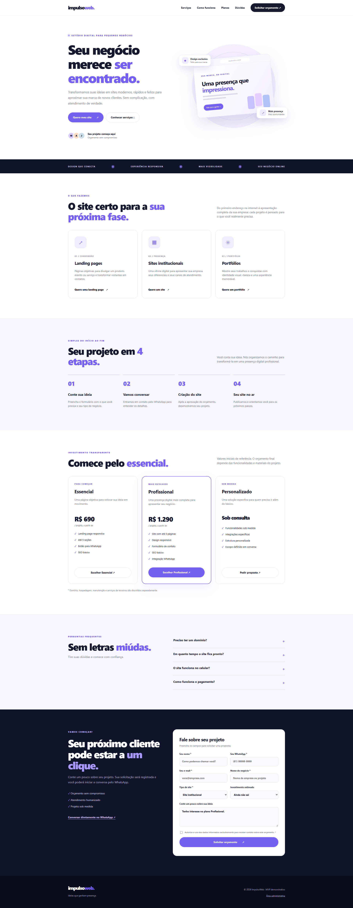

# ImpulsoWeb

MVP de um estúdio digital que cria landing pages, sites institucionais e portfólios para pequenos negócios. O projeto reúne uma página pública para apresentar os serviços e captar pedidos de orçamento e um painel privado para organizar os contatos recebidos.




## Visão geral

Pequenos empreendedores podem depender apenas de redes sociais e mensagens para apresentar seus serviços. A ImpulsoWeb propõe uma presença digital profissional, com solicitação de orçamento simples e atendimento feito diretamente pelo WhatsApp.

O fechamento de projetos é manual. Pagamentos, contratos, automações de e-mail e integrações com CRM não fazem parte deste MVP.

## Funcionalidades

### Site público

- Apresentação dos serviços, etapas de atendimento, planos e perguntas frequentes.
- Layout responsivo para celular, tablet e desktop.
- Formulário de orçamento com validação e aviso de privacidade.
- Registro dos pedidos no servidor e encaminhamento da conversa para o WhatsApp.
- Navegação adaptada para dispositivos móveis e suporte à preferência por movimento reduzido.

### Painel administrativo

- Autenticação por e-mail e senha, com sessão protegida.
- Visão geral de leads e clientes.
- Busca e filtro de solicitações.
- Atualização de status, conversão em cliente e acompanhamento da etapa do projeto.
- Criação, conclusão e remoção de lembretes.

## Tecnologias

- **Interface:** HTML, CSS e JavaScript.
- **Servidor:** Node.js e módulos nativos de HTTP e sistema de arquivos.
- **Persistência:** arquivo JSON local.
- **Testes:** `node:test` e `node:assert`.

Não há dependências de npm para instalar. É necessário ter **Node.js 20 ou superior**.

## Inicie o projeto

Na pasta do projeto, execute:

```bash
npm start
```

Depois, acesse **http://127.0.0.1:3000** no navegador. Para abrir a área administrativa, use o link **Área administrativa** no rodapé do site.

Para executar os testes automatizados:

```bash
npm test
```

## Configuração

O servidor carrega as variáveis de um arquivo `.env` na raiz do projeto, quando ele existe. Configure pelo menos `ADMIN_EMAIL` e `ADMIN_PASSWORD` para habilitar o login administrativo. A senha precisa ter **no mínimo 12 caracteres**.

Exemplo de configuração — substitua os valores de exemplo e não compartilhe credenciais reais:

```env
ADMIN_EMAIL=admin@exemplo.com
ADMIN_PASSWORD=substitua-por-uma-senha-segura
WHATSAPP_NUMBER=5581999999999
```

`WHATSAPP_NUMBER` deve conter DDI, DDD e número, somente com algarismos. Sem essa configuração, o encaminhamento para o WhatsApp não terá um número de atendimento definido.

| Variável | Finalidade | Padrão |
| --- | --- | --- |
| `ADMIN_EMAIL` | E-mail usado no acesso administrativo | Não configurado |
| `ADMIN_PASSWORD` | Senha administrativa (mínimo de 12 caracteres) | Não configurado |
| `WHATSAPP_NUMBER` | Número de atendimento com DDI e DDD | Não configurado |
| `PORT` | Porta HTTP do servidor | `3000` |
| `HOST` | Interface de rede em que o servidor escuta | `127.0.0.1` |
| `DATA_FILE` | Caminho absoluto do arquivo de dados JSON | `data/db.json` |
| `NODE_ENV` | Ambiente de execução; em `production`, habilita cookie `Secure` | — |

O arquivo `.env` e os dados de clientes não devem ser enviados ao Git ou compartilhados. Em produção, use HTTPS ao configurar `NODE_ENV=production`.

## Estrutura do projeto

```text
impulsoweb/
├── data/                       # Dados locais gerados pela aplicação
├── docs/                       # Prompts e checklist de revisão
├── public/
│   ├── assets/img/              # Imagens do site e do README
│   ├── admin.html               # Interface administrativa
│   ├── admin.js                 # Comportamento do painel
│   ├── app.js                   # Comportamento do site público
│   ├── index.html               # Página inicial
│   └── style.css                # Estilos
├── test/
│   └── mvp.test.js              # Testes automatizados
├── package.json
├── README.md
└── server.js                    # Servidor HTTP e API
```

## Fluxos principais

**Solicitação de orçamento:** a pessoa visita o site, preenche o formulário e aceita o aviso de privacidade. O servidor valida e salva o pedido; em seguida, a pessoa pode continuar o atendimento pelo WhatsApp.

**Atendimento administrativo:** o administrador entra no painel, consulta os leads, atualiza o status, acompanha projetos e organiza próximos contatos com lembretes.

## Persistência e implantação

Os registros são salvos em JSON no caminho de `DATA_FILE` (por padrão, `data/db.json`). As sessões ficam na memória do processo e são encerradas quando o servidor reinicia.

Para publicar, use uma hospedagem que execute Node.js continuamente, ofereça HTTPS e permita configurar variáveis de ambiente e armazenamento persistente. Configure `HOST=0.0.0.0` quando a plataforma exigir que a aplicação escute em todas as interfaces. Aponte `DATA_FILE` para um volume persistente.

Esta implementação é um MVP para validação, não uma infraestrutura escalável: o arquivo JSON e as sessões em memória não foram projetados para múltiplas instâncias. Para esse cenário, use armazenamento e sessões gerenciados, além de backups e controles operacionais adequados.

## Validação da proposta

A hipótese é que pequenos negócios interessados em melhorar sua presença digital solicitarão um orçamento e aceitarão conversar sobre o serviço. Um formulário enviado, por si só, **não comprova demanda nem venda**; a validação comercial depende de conversas e contratos pagos reais.

Uma experiência inicial pode divulgar a página a empreendedores do público-alvo, registrar objeções e acompanhar pedidos qualificados e propostas aceitas. Defina metas como hipóteses de teste, não como resultados já alcançados. O MVP não mede visitas automaticamente.

## Segurança e privacidade

- Não publique `.env`, `data/db.json`, credenciais ou capturas de tela com dados pessoais.
- O painel requer autenticação; cookies de sessão usam `HttpOnly` e `SameSite=Strict`, e também `Secure` em produção.
- O servidor valida os dados recebidos e aplica limites básicos a tentativas de login e envio de formulários.
- Antes de operar comercialmente, defina uma política de privacidade adequada, prazo de retenção e canal para solicitações de titulares, considerando a LGPD.
- Para uso público contínuo, avalie armazenamento durável, backups, logs de auditoria e controles adicionais contra abuso.
